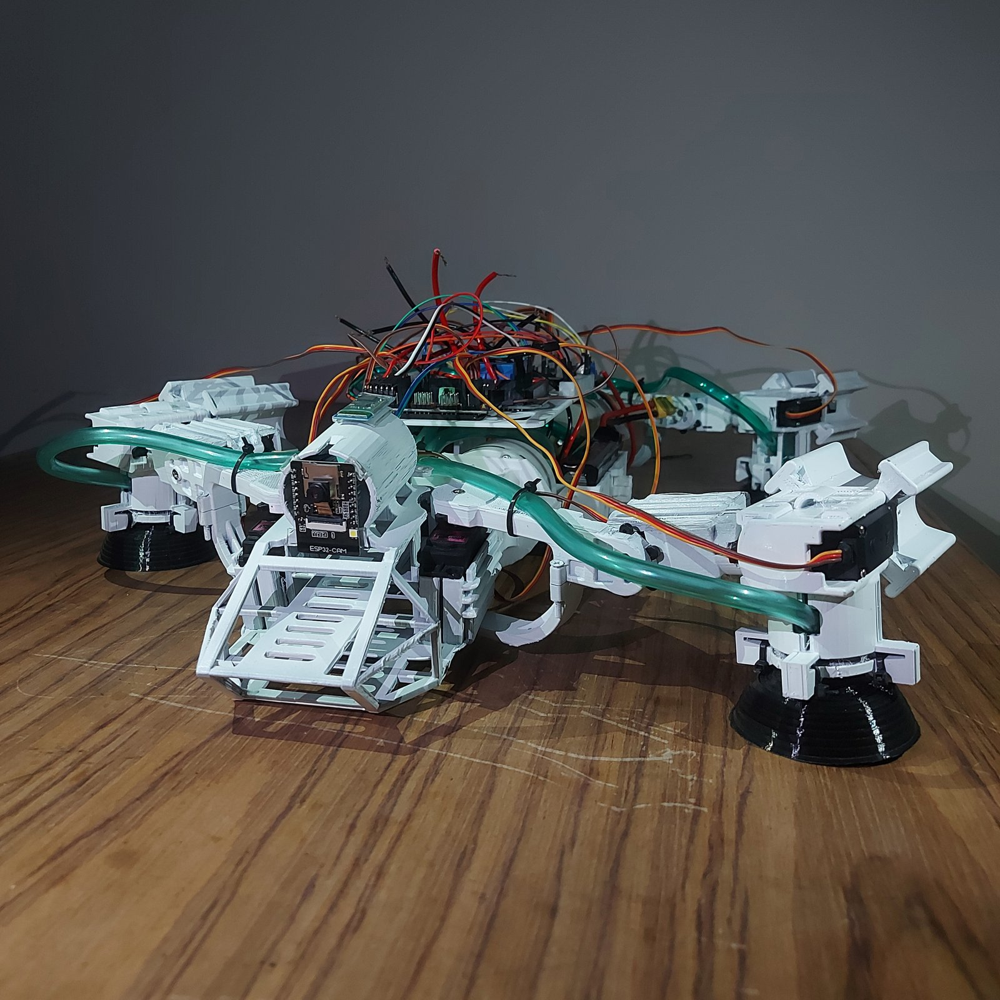
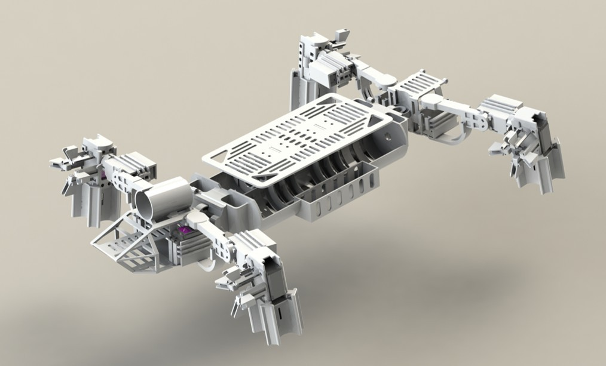
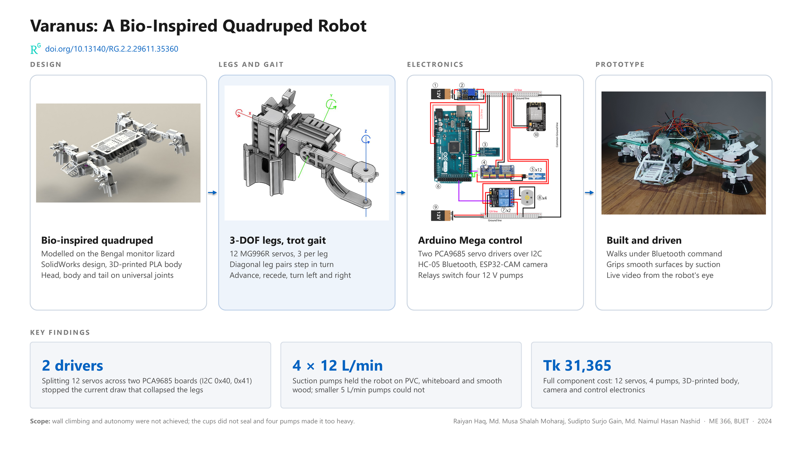
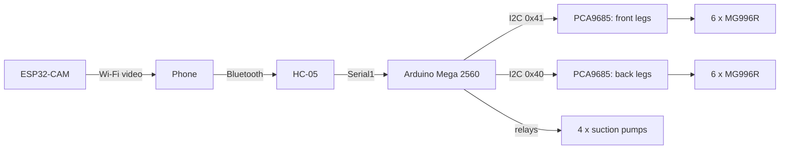

# Varanus: A Bio-Inspired Quadruped Robot

Arduino and ESP32-CAM code for Varanus, a 12-servo, four-legged robot modelled on the Bengal monitor lizard. It walks with a trot gait under Bluetooth control, streams live video from its head camera and carries a suction pump on each leg. Team project for the ME 366 course at BUET, December 2023 to March 2024.

This repository is a project showcase, not a maintained library.

## Demo

| The robot | The team's SOLIDWORKS design |
|---|---|
|  |  |

## Features

- **Trot gait.** Diagonal legs move in pairs (left front with right back, then right front with left back) to step forward, step back and turn left or right.
- **Bluetooth control.** One-letter commands from a phone over an HC-05 module: `A` neutral stance, `B` forward, `C` back, `D` turn left, `E` turn right.
- **Live video.** An ESP32-CAM in the head serves a video stream over Wi-Fi.
- **Suction feet.** A 12 V pump per leg, switched through relays, with TPU suction cups.
- **Two servo drivers.** One PCA9685 board could not supply all 12 MG996R servos, and the legs collapsed under load. Splitting the servos across two boards (the second moved to I2C address `0x41` by bridging its A0 pad) fixed it.

**Limits.** The robot walks on flat ground but could not climb inclined or vertical surfaces: the leg geometry could not press the cups onto a surface, and the 3D-printed TPU cups were too stiff to seal. The planned autonomous mode was not built. The [project report](https://doi.org/10.13140/RG.2.2.29611.35360) covers both.

## Installation and getting started

Prerequisites: the [Arduino IDE](https://www.arduino.cc/en/software), the **Adafruit PWM Servo Driver** library (Library Manager), and for the camera the **esp32** board package by Espressif (Boards Manager).

| Hardware | Count |
|---|---|
| Arduino Mega 2560 | 1 |
| PCA9685 16-channel servo driver | 2 |
| MG996R servo, 180° | 12 |
| HC-05 Bluetooth module | 1 |
| ESP32-CAM (AI-Thinker) | 1 |
| 12 V, 12 L/min suction pump | 4 |
| 12 V dual-channel relay | 2 |
| 12 V 2200 mAh LiPo battery | 2 |
| 12 V to 5 V buck converter | 1 |

Wiring: [`docs/wiring-diagram.png`](docs/wiring-diagram.png). The diagram shows a single servo driver; the second board is wired in parallel on the same I2C bus.

No releases are published: open a sketch in the Arduino IDE and upload it.

## Configuration

- **Servo drivers:** the final gait sketch expects the back-leg board at `0x40` and the front-leg board at `0x41`. Run `setup/i2c_address_finder` to check yours.
- **Camera:** set your Wi-Fi name and password at the top of `camera/camera_web_server/camera_web_server.ino` before uploading, and choose the AI-Thinker ESP32-CAM board.

## Usage

Sketches are grouped in [`firmware/`](firmware/) in the order they were used:

| Folder | Sketch | Purpose |
|---|---|---|
| `setup/` | `servo_calibration` | Hold one servo, wired straight to the Mega, at 90° |
| | `single_servo_control` | Drive one servo through a PCA9685 board |
| | `i2c_address_finder` | List the I2C addresses on the bus |
| | `two_driver_test` | Drive servos on both PCA9685 boards |
| | `set_all_servos_90` | Hold every joint at 90°, the neutral pose |
| `gait/` | `two_leg_walk_test` | Move two legs on Bluetooth commands, one board |
| | `bipedal_walk_test` | The same two-leg test across both boards |
| | `horizontal_walk` | Full trot gait with Bluetooth commands |
| | `horizontal_walk_tuned` | **Final version:** the same gait with each joint's neutral angle tuned |
| `control/` | `bluetooth_walk_test` | First Bluetooth command test, all four legs on one board |
| `suction/` | `four_pump_control` | Toggle each leg's pump with a letter command |
| | `pump_attach_with_servo_lock` | Hold every joint at 90° while toggling the pumps |
| `camera/` | `camera_web_server` | ESP32-CAM video stream |

To drive the robot, upload `gait/horizontal_walk_tuned` to the Mega, pair a phone with the HC-05, and send the letters above from any Bluetooth serial terminal app.

## Tech stack and architecture

Arduino C++ on an Arduino Mega 2560, I2C to two PCA9685 servo drivers, UART to the HC-05, digital outputs to the pump relays, and a separate ESP32-CAM running Espressif's camera web server.

## Security and privacy

The only credentials are the Wi-Fi name and password in the camera sketch, which ship as placeholders. The video stream has no password, so use it only on a network you trust.

## Development

The project is complete and not under development. The full design, the challenges and proposed fixes are in the [report](https://doi.org/10.13140/RG.2.2.29611.35360) and [poster](https://doi.org/10.13140/RG.2.2.14392.66564) on ResearchGate.

## Credits, license and support

- **Team Randomness, ME 366, BUET:** Raiyan Haq, Md. Musa Shalah Moharaj, Sudipto Surjo Gain and Md. Naimul Hasan Nashid. Supervisor: Dr. Kazi Arafat Rahman.
- **My part:** the electronics and control. I wired the robot, split the servos across the two drivers, wrote the gait and Bluetooth code, set up the ESP32-CAM, and helped build, assemble and test it. The mechanical design was done by my teammates.
- `firmware/camera/camera_web_server/` is Espressif's CameraWebServer example from [arduino-esp32](https://github.com/espressif/arduino-esp32), Apache License 2.0 ([copy](third_party_licenses/Apache-2.0.txt)).
- No license is granted for the rest of this repository: it is shared to show the work, not for reuse.
- This is a personal showcase, so issues and pull requests are not monitored.
